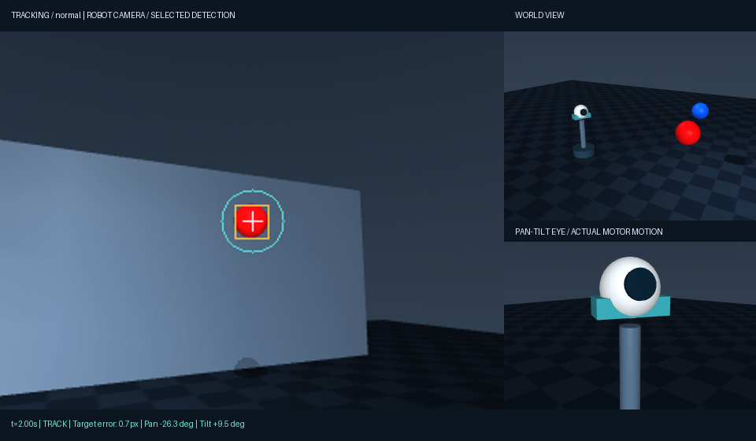

# Robotic Eye Tracker

A simulated pan-tilt robotic eye follows a moving red ball using RGB images and motor encoders. MuJoCo simulates the motors; OpenCV finds candidate objects; a motion filter and state machine handle tracking, short occlusions, and search.



## Watch the experiment

Download or clone the repository and open `reports/report.html`, keeping its neighboring video files in place. Alternatively:

```sh
python -m http.server 8778 --bind 127.0.0.1 --directory reports
```

Open http://127.0.0.1:8778/report.html. The report has six recorded trials, synchronized motor angles and tracking states, error charts, and all evaluation results. It is a replay interface, not a live simulation or hardware controller.

## Results

Five reserved seeds (100–104), six comparison groups, 10 seconds per trial, 25 frames per second: 30 trials and 7,500 frames. Every trial is retained. Videos show seed 100 in every group, not the best run.

| Condition | Centered frames | Target visible | Mean visible error | Correct selection / visible | Selection precision |
|---|---:|---:|---:|---:|---:|
| Fixed camera | 4.9% | 100.0% | 90.47 px | 98.6% | 100.0% |
| Tracking, normal | 98.9% | 100.0% | 4.77 px | 98.7% | 100.0% |
| Occlusion | 83.5% | 88.0% | 6.80 px | 98.9% | 100.0% |
| Low exposure | 98.9% | 100.0% | 4.75 px | 98.8% | 100.0% |
| Fast motion | 17.3% | 99.8% | 47.54 px | 99.0% | 100.0% |
| Similar red object | 44.8% | 73.0% | 40.67 px | 53.9% | 39.5% |

Centered means the true target is visible and its projected center lies within 20 pixels of the 320 × 240 image center. The denominator includes all frames, including occlusion. Visible means at least eight target pixels in a separate ground-truth segmentation render. Mean error and selection recall use visible frames only. Precision counts selected centroids inside the target mask divided by all selected detections. These are descriptive frame-weighted metrics, not confidence intervals: adjacent frames are correlated.

All five occlusion trials regained a confirmed correct track 0.08 seconds after the screen was removed. This measures three-hit track confirmation, not return to the center. The similar-object test produced 755 incorrect selected detections, not 755 identity switches.

## Install and reproduce

Python 3.11+; the published run used Python 3.12 on Windows. A working OpenGL driver/context is needed to render the evaluation. Unit tests do not render. No camera, cloud service, credentials, or model download is needed.

```sh
python -m venv .venv
# Windows PowerShell:
.venv/Scripts/Activate.ps1
# macOS/Linux: source .venv/bin/activate
python -m pip install -e ".[video]"
python -m unittest discover -s tests -v
python -m eye_lab.evaluate --out reports/custom
python -m eye_lab.report --out reports/custom
python -m http.server 8778 --bind 127.0.0.1 --directory reports/custom
```

`--no-video` skips MP4 creation; that output still contains metrics but its report will not have playable replays. `--count N` changes the number of seeds starting at 100. Keep published results in `reports/`; use `reports/custom` for new runs. `requirements-lock.txt` records the exact installed dependencies; use `pip install -r requirements-lock.txt` before `pip install --no-deps -e .` to reproduce that package set where wheels are available. Rendering differences across platforms can change pixels and results.

On Windows, MuJoCo requires the [Microsoft Visual C++ runtime](https://learn.microsoft.com/en-us/cpp/windows/latest-supported-vc-redist?view=msvc-170). If a trusted runtime is already installed in a nonstandard directory, the optional `EYE_LAB_DLL_DIR` environment variable adds that directory only to this Python process. The project does not install or redistribute runtime DLLs.

## How it works

1. A camera mounted on two simulated hinge joints supplies RGB frames at 25 Hz. Position actuators move the eye through MuJoCo physics at a 0.002-second timestep.
2. HSV thresholding uses hue 0–10 or 170–179, saturation ≥110, value ≥25. A 3 × 3 opening and contour area ≥14 / circularity ≥0.5 reject small irregular regions.
3. Camera bearings are transformed using measured pan/tilt angles. The first acquisition chooses the largest red candidate; later observations are gated against the predicted bearing.
4. An alpha-beta filter (alpha 0.65, beta 0.08) estimates angular motion, with a 0.10-second command lookahead. Estimated velocity is clipped to ±1.8 rad/s.
5. ACQUIRE needs three consecutive detections to become TRACK. Missing detections enter COAST for up to 0.48 seconds, then SEARCH scans around the last known bearing. Reacquisition again requires confirmation.
6. Commands respect pan [−1.35, 1.35] and tilt [−0.65, 0.75] radians, with a 1.2 rad/s command slew limit. Actuators have ±4 Nm force bounds. Command slew is not a hard bound on actual joint velocity.

The controller receives only RGB pixels, two encoder angles, and elapsed time. Target coordinates and segmentation are used by the scorer after the action is chosen, never passed into the controller. The fixed-camera baseline uses the same scene and detector while motor commands remain zero.

Normal horizontal trajectory frequency is 0.65 rad/s; fast motion uses 3.0 rad/s. A screen occludes the target from 4.00 to 5.20 seconds. Low exposure scales the camera RGB image to 22% brightness and adds Gaussian pixel noise (sigma 2); it is not a physically calibrated illumination model. A second red object enters after three seconds in the identity stress test.

## Scope and limitations

This is classical vision and feedback control for a known-color synthetic ball. There is no neural training, general-purpose detector, or learned policy. The object motion is scripted; the eye motion is produced by simulated motors. Fast motion and lookalike objects expose clear failures. A TRACK state does not guarantee correct identity. Five reserved seeds vary a narrow trajectory family, so these results do not establish generalization to real cameras or arbitrary objects. Physical motor control is not implemented.

Development used seed 7. A failed dim-image development run led to lowering the value threshold from 65 to 25. The controller and scene were frozen before running seeds 100–104. `reports/evaluation.json` contains all frame traces, package versions, protocol, and SHA-256 hashes of the evaluated source (UTF-8 text normalized to LF).

## Project map

- `eye_lab/scene.xml`: original eye, motors, target and scene.
- `eye_lab/vision.py`, `controller.py`: pixel perception and tracking/control.
- `eye_lab/simulation.py`, `evaluate.py`: scene generation, independent scoring, trials and video rendering.
- `eye_lab/report.py`, `template.html`: interactive replay report.
- `tests/test_eye.py`: detector, geometry, state transitions, limits and motor dynamics.
- `scripts/package_project.py`: package only public source and experiment files.

See [VALIDATION.md](VALIDATION.md) for verification and CI status, and [ATTRIBUTION.md](ATTRIBUTION.md) for dependencies. Original project code and scene are MIT licensed.
